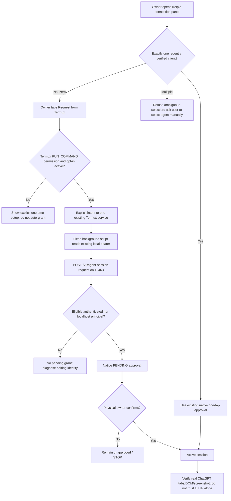

# R5 private QA — owner-initiated Termux reconnect (review gated)

Date: 2026-11-19  
Source branch: `fix/r5-mother-atomic-webview-switch-20261119` (existing Draft PR #71)  
Target: existing single owner S24 package `com.kelpie.browser.r5mothernextverify`, browser `18463`, Termux `8080`.  
Status: **SOURCE ONLY — NOT INSTALLED / NOT VALIDATED ON S24.**

## Problem and user evidence

The owner has no simple self-service way to restart an agent approval when no authenticated
remote agent has been observed in the last 120 seconds. The existing
`R5OneTapConsentAction` works for exactly one recently verified non-localhost principal.

The owner confirmed that native approval and remote ChatGPT control worked even while a
separate manual Termux POST reported HTTP 500. The earlier `PENDING_INDICATED=False`
diagnostic was a JSON parse fallback, not native-state evidence. Therefore the bridge
MUST NOT equate its command result or any HTTP error with owner approval or connectivity.

## Reuse-first architecture

1. **Recently verified, unique principal**: use the existing native
   `Allow control for this session` path. No Termux or extra confirmation is needed
   beyond the explicit owner gesture.
2. **No recent verified principal**: the owner can tap **درخواست اتصال از Termux** in
   `AgentConnectionCenterSheet` with ChatGPT Secure MCP Tunnel selected. This does
   **not** approve a session. It sends one Android explicit `RUN_COMMAND` intent
   to the already-installed Termux `RunCommandService`.
3. Termux executes only the pre-reviewed fixed script at
   `~/.local/bin/ef-kelpie-request-consent`; the script enters the existing Ubuntu
   PRoot, reads the existing owner's Authorization file *in Termux/Ubuntu*, and
   calls `POST http://127.0.0.1:18463/v1/agent-session-request`.
4. Kelpie's existing authenticated `AgentSessionCoordinator` may create
   `PENDING_NATIVE_APPROVAL` only for an eligible verified principal while the
   app is visible, resumed and unlocked. A **separate explicit native approval**
   grants the session; STOP still revokes it.
5. Do not infer success from `startService`, script exit, HTTP 200/403/500, or
   a Termux notification. Show `QUEUED_NOT_CONFIRMED` until observed native session
   evidence. The existing owner consent UI is the source of truth.

## Android/Termux one-time prerequisites

- Optional Android QA manifest only (not release) declares
  `com.termux.permission.RUN_COMMAND` and package visibility `com.termux`.
- User explicitly grants Kelpie **Additional permissions → Run commands in Termux
  environment**. Never grant or bypass this programmatically.
- Termux owner explicitly sets `allow-external-apps=true` in
  `~/.termux/termux.properties` and reloads settings. This broadens Termux
  execution rights for apps holding the permission; therefore it is owner
  opt-in and **private QA only**, with revocation instructions.
- User installs the reviewed executable as a single Termux private file, mode
  0700. Do not run arbitrary paths, shell command strings, script stdin from
  Android, or transmit tokens through Intent extras.
- `RUN_COMMAND_BACKGROUND=true`; no Termux foreground Activity pop-up, no
  second tunnel, no duplicate Kelpie package, no power exemption changes.
- No extra Bearer or renewal key is minted. If the current saved token
  resolves only to `localhost` or an unpaired/expired principal, refuse.
  Static header equality does NOT prove eligible native agent identity.
- Android 17 and Termux vendor-specific behavior must be checked on the real S24
  before acceptance. `startService` returning a ComponentName is only dispatch
  to Termux, not proof the command ran.
- Correct file name and script SHA-256 must be captured during controlled deployment.

## Functional and regression acceptance gates

| ID | Requirement |
|---|---|
| BR-01 | 1 fresh verified principal → existing native one-tap only; no Termux process |
| BR-02 | No recent principal → fixed Termux button visible for secure tunnel |
| BR-03 | Two or more observed principals → no automatic choice or Termux fallback |
| BR-04 | Missing Termux permission → no command; explain manual grant |
| BR-05 | Missing script or `allow-external-apps` → no false success status |
| BR-06 | Explicit button sends exactly one fixed background command, no sensitive extras |
| BR-07 | 15-second local debounce prevents repeated flooding |
| BR-08 | Wrong/expired bearer or `localhost` → no native approval |
| BR-09 | Valid paired principal → native prompt → owner tap → verified active state |
| BR-10 | HTTP500 after native prompt cannot override owner approval |
| BR-11 | Lock, STOP, process loss, reboot remain separate controls |
| BR-12 | ChatGPT `tabs.list`, DOM, screenshots and an action test individually pass |
| BR-13 | Existing 18463/8080 unchanged; one package, one Termux, no auto-install |
| BR-14 | Same-signer backup+recovery and S24 release gate must pass |
| BR-15 | Termux-specific Android exception to AGENTS.md iOS parity formally reviewed before merge |

## Limitations and review blockers

This first source iteration uses `startService` and observes native pending/active
state; it does **not** yet wire the optional Termux `PendingIntent` callback to report
script completion. A queued command may never execute if permissions are missing,
the script is not installed, Android denies the background service, or PRoot fails.

The broad `RUN_COMMAND` permission is deliberately declared **only** in the existing
R5 debug QA manifest overlay. It is not enabled or granted on the real device.
A more minimal native reconnect control based solely on an already paired identity
is preferable if a documented principal revalidation path can be implemented.
This optional Termux bridge must not become the default for all Kelpie users.

Also, the installed APK signing certificate differs from GitHub CI APK. Do not
install, uninstall, create a second package, or reset the private profile to test
this feature before signer-safe in-place upgrade / data recovery is independently
validated. CI success alone is NOT physical-device acceptance.

## Official sources consulted

- Termux official RUN_COMMAND documentation:
  https://github.com/termux/termux-app/wiki/RUN_COMMAND-Intent
- TermuxConstants:
  https://github.com/termux/termux-app/blob/master/termux-shared/src/main/java/com/termux/shared/termux/TermuxConstants.java
- Termux tools `allow-external-apps`:
  https://github.com/termux/termux-tools/blob/master/doc/termux.1.md.in
- Android background Activity restrictions:
  https://developer.android.com/guide/components/activities/secure-bal
- Repo source: `AGENTS.md`, `AgentConnectionCenterSheet`, `R5OneTapConsentAction`,
  `R5ObservedAgentClients`, `AuthMiddleware`, `AgentSessionCoordinator`,
  `Router`, `R5McpBootstrapGate`, QA manifest, exact installed APK evidence in
  ENERFOAM Issue #98.

Status: `SOURCE_PROTOTYPE / OWNER_REVIEW_GATED / TERMUX_PRIVILEGE_NOT_GRANTED /
NO_PHYSICAL_DEVICE_INSTALL / SYNC_BLOCKED_MAIN`.
